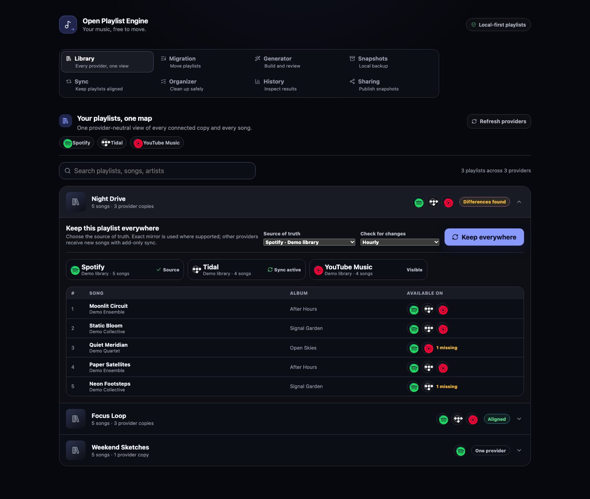

# Open Playlist Engine

[](https://github.com/mbianchidev/open-playlist-engine/actions/workflows/ci.yml)
[](https://mbianchidev.github.io/open-playlist-engine/)

[Website](https://mbianchidev.github.io/open-playlist-engine/) ·
[Documentation](docs/README.md) ·
[Issues](https://github.com/mbianchidev/open-playlist-engine/issues) ·
[Releases](https://github.com/mbianchidev/open-playlist-engine/releases)



*The current Library workspace, captured from the running app with synthetic
accounts and tracks. No real provider credentials or personal library data are shown.*

## Overview

Open Playlist Engine is a self-hosted web app for music listeners who want to
**move, generate, back up, and organize playlists without being tied to one
provider**. Migrate playlists and supported music-library collections across
Spotify, Tidal, YouTube Music, and Apple Music, review uncertain matches, and keep
portable exports on your own instance. It moves music-library metadata, not audio.

It is the first reference implementation of the
[`open-playlist`](https://github.com/mbianchidev/open-playlist) universal
`Playlist`/`Track` specification. Providers are plugin spokes around that universal
format, so each new provider can work with every existing provider as both a source
and a target.

> **Status:** Early MVP for single-user self-hosting. The features below are
> implemented, but provider support is not identical. The UI uses backend
> capabilities to disable unsupported operations. Hosted multi-user authentication
> is not implemented.

## Contents

[Quick start](#quick-start) · [Why Open Playlist Engine](#why-open-playlist-engine) ·
[How it works](#how-it-works) · [Usage](#usage) ·
[Configuration](#configuration) · [Features](#features) ·
[Supported providers](#supported-providers) · [Limitations](#limitations) ·
[Documentation](#documentation) · [AI policy](#ai-policy) ·
[Contributing](#contributing) · [Security](#security) · [License](#license)

## Quick start

### Prerequisites

- Git, a Docker-compatible container engine, and Docker Compose v2 or later.
- A host capable of running Linux containers. On macOS or Windows, use a compatible
  Linux-container runtime; the shell examples below use a POSIX shell.
- A modern browser and internet access to the providers you use.
- Provider accounts and developer-app credentials for the integrations you connect.
  Apple Music additionally requires Apple Developer Program membership and an
  active Apple Music subscription.

The container setup supplies Python, Node.js, PostgreSQL 18, Valkey 9, the API,
background worker, and frontend. Host Python/Node.js installations and an AI model
are not required.

> **Upgrading an existing deployment?** Complete the
> [PostgreSQL 17-to-18 data migration](docs/POSTGRES_UPGRADE.md) before starting this
> version. Do not attach a PostgreSQL 17 data volume directly to PostgreSQL 18.

### Install and start

Clone the repository and create your local settings:

```bash
git clone https://github.com/mbianchidev/open-playlist-engine.git
cd open-playlist-engine
cp .env.example .env
```

Before starting, edit `.env`:

- Replace `OPE_SECRET_KEY` with a random value of at least 32 characters, for example
  one generated by `openssl rand -hex 32`. Keep this key stable: it encrypts stored
  provider credentials.
- Add credentials only for the providers you intend to connect, following the
  [provider setup guide](docs/CONNECTING_PROVIDERS.md). Spotify and Tidal callback
  URLs must match the registered `http://127.0.0.1:8000/...` URLs exactly.
- Leave `OPE_PUBLIC_BASE_URL` empty for a private local instance. Keep `.env` and
  provider session headers out of version control.

Run these commands from the repository root:

```bash
docker compose config --quiet
docker compose build --no-cache
docker compose up --detach
```

The backend and worker apply database migrations on startup. Initial image builds
and database initialization can take a few minutes.

- App: <http://localhost:8080>
- API documentation: <http://localhost:8000/docs>
- API health: <http://localhost:8000/health>

Check that the API is reachable through the frontend proxy:

```bash
curl --fail http://localhost:8080/health
```

The response includes `"status":"ok"` and `"mode":"self_host"`. This checks API
availability, not provider credentials or the worker. If startup fails, inspect
`docker compose logs --tail=100 backend worker`.

Stop the stack with `docker compose down`. Database and snapshot volumes survive
normal shutdown; `docker compose down --volumes` deletes them.

## Why Open Playlist Engine

- **Keep control:** self-host provider credentials, migration history, and
  metadata-only backups.
- **Use one workflow:** move between providers or import files, public URLs, and
  pasted track lists without learning a different migration tool for each pair.
- **Review the evidence:** inspect uncertain matches and per-item results instead
  of assuming every catalog match is correct.
- **Keep an exit path:** export playlists without connecting a target provider.

## How it works

```text
provider, file, URL, or text ─▶ [ Open Playlist hub ] ─▶ target provider
                                      │
                                      └───────────────▶ local export
```

Migrations follow a durable **import → match → review → write** pipeline. Matching
uses provider identifiers and an evidence graph; low-confidence results require
human review before those items are written. A FastAPI API and ARQ worker manage
jobs in PostgreSQL and Valkey, while the React frontend uses the generated API
contract. See the [system tour](docs/HOW_IT_WORKS.md) and
[design guide](docs/DESIGN.md) for the architecture and trust boundaries.

## Usage

1. Open **Migration**, choose **From** and **To**, and connect the required provider
   accounts. Use **Test connection** before a first migration. Alternatively,
   choose **Local playlist file**, **Public playlist URL**, or **Pasted playlist
   text** as the source and preview it.
2. Load and select playlists or individual tracks. Spotify and Tidal also expose
   saved albums and followed/favorite artists. Review preflight warnings before
   starting; native liked-track collections map to a supported target's native
   library rather than a newly created playlist.
3. Start the migration and watch live progress. Approve, replace, or skip
   low-confidence matches when prompted. Reopen **History** to inspect results,
   errors, and downloadable reports.
4. To export instead of migrating, select playlists from a connected provider and
   download a portable format without connecting a target account.

The default **Library** workspace groups logical playlists across connected
providers. **Snapshots** stores metadata-only backups locally; **Sync** manages
recurring one-way rules; **Organizer** exposes only the cleanup actions each
provider supports. See the [feature guides](#features) for their safety and
recovery behavior.

## Configuration

All backend settings use the `OPE_` prefix. The complete template is
[`.env.example`](.env.example); units, defaults, and operational relationships are
documented in the [configuration guide](docs/CONFIGURATION.md).

| Setting or group | When to change it |
|---|---|
| `OPE_SECRET_KEY` | Set before connecting accounts; preserve it with deployment backups |
| `OPE_FRONTEND_URL` | Change the browser origin for redirects and CORS; defaults to `http://localhost:8080` |
| Provider credentials and redirect URLs | Configure only the integrations you use; see [Connecting providers](docs/CONNECTING_PROVIDERS.md) |
| `OPE_MIGRATION_SAFE_*` | Adjust the default warnings: 1 playlist/job, 50 tracks/job, 250 tracks/day, and 120 seconds between jobs |
| `OPE_SNAPSHOT_DIR` | Use durable storage writable by both API and worker; Compose shares `/data/snapshots` |
| `OPE_GENERATOR_*` | Enable an optional model endpoint/backend and model name |
| `OPE_PUBLIC_BASE_URL`, `OPE_OWNER_ACCESS_TOKEN` | Enable opt-in sharing with a separate strong owner token; see [Sharing](docs/PLAYLIST_SHARING.md) |

After editing the root `.env`, recreate the application services to load it:

```bash
docker compose up --detach --force-recreate backend worker
```

**Generator** stays disabled until configured. The default backend can use a local
OpenAI-compatible server; the optional Ollama Compose profile and GitHub Copilot
SDK backend are covered in the [generator guide](docs/PLAYLIST_GENERATOR.md).
Using a remote model endpoint or Copilot sends generation context to that service;
local-first does not mean offline.

## Features

| Capability | What it provides | Guide |
|---|---|---|
| Playlist migration | Track selection, matching, review, duplicate protection, and live progress | [Design](docs/DESIGN.md) |
| Unified playlists | Provider-neutral playlist and song coverage with keep-everywhere sync | [Unified playlists](docs/UNIFIED_PLAYLISTS.md) |
| Local file imports | TXT, CSV, M3U/M3U8, PLS, WPL, XSPF, XML, and JSON sources | [Local imports](docs/LOCAL_FILE_IMPORTS.md) |
| URL and text imports | Bounded public playlist URLs and pasted track lists | [Import sources](docs/IMPORT_SOURCES.md) |
| Portable exports | CSV, TXT, M3U8, XSPF, JSON, and multi-playlist ZIP downloads | [Exports](docs/EXPORTING_PLAYLISTS.md) |
| Playlist generator | Private editable drafts resolved to real provider tracks before writing | [Generator](docs/PLAYLIST_GENERATOR.md) |
| Library snapshots | Versioned, metadata-only local backups, verification, diff, and restore | [Snapshots](docs/SNAPSHOTS.md) |
| Scheduled sync | Persistent add-only and capability-gated mirror rules | [Synchronization](docs/SYNCHRONIZATION.md) |
| Playlist Organizer | Capability-gated library cleanup with preflight and durable retries | [Organizer](docs/PLAYLIST_ORGANIZER.md) |
| History and reports | Reopenable migrations, statistics, and streamed CSV/JSON reports | [Migration history](docs/MIGRATION_HISTORY.md) |
| Playlist sharing | Opt-in immutable snapshots with isolated recipient credentials | [Sharing](docs/PLAYLIST_SHARING.md) |

### Supported providers

| Provider | Playlists | Native liked tracks | Saved albums | Followed/favorite artists |
|---|---|---|---|---|
| Spotify | Read/write | Read/write | Read/write | Read/write as follows |
| Tidal | Read/write | Read/write | Read/write | Read/write as favorites |
| YouTube Music | Read/write | Read/write | Unsupported | Unsupported |
| Apple Music | Read/create/add | Unsupported | Unsupported | Unsupported |

Exact source, target, authentication, and Organizer capabilities are provider-driven.
For app registration, callback URLs, scopes, and connection behavior, see
[`docs/CONNECTING_PROVIDERS.md`](docs/CONNECTING_PROVIDERS.md).

Spotify and Tidal use official OAuth APIs. YouTube Music uses the unofficial,
experimental `ytmusicapi` integration. Apple Music uses the official MusicKit
developer-token and user-token flow and is currently beta.

### Limitations

- This app migrates metadata, not music files, DRM, subscriptions, or audio.
  Catalog availability, account permissions, scopes, and provider rate limits can
  prevent individual matches or writes.
- Default `self_host` mode has no owner login while sharing is disabled. Keep it
  on a trusted local network; do not expose the default stack publicly.
  `OPE_DEPLOYMENT_MODE=hosted` is not a hosted-service setup: protected operations
  currently return HTTP 501 because multi-user authentication is not configured.
- YouTube Music's unofficial API may break and carries account-flag risk.
  Browser-session header paste is available only in self-host mode.
- Apple Music has no native liked-track migration, saved-album/artist migration,
  or Organizer delete/remove support in this implementation. New playlist writes
  may take time to appear.
- URL imports accept supported playlist/share links, not arbitrary web-page
  scraping. Spotify and Tidal links can require a connected source account.
- Scheduled sync is one-way. Mirror mode currently targets standard Spotify
  playlists only; liked-track collections remain add-only.

## Documentation

Browse the rendered [documentation website](https://mbianchidev.github.io/open-playlist-engine/)
or the categorized [`docs/` source index](docs/README.md). Start with:

- [Configuration](docs/CONFIGURATION.md)
- [Connecting providers](docs/CONNECTING_PROVIDERS.md)
- [Product purpose and design principles](docs/PRODUCT.md)
- [Architecture and provider contract](docs/DESIGN.md)
- [Continuous integration](docs/CI.md)

## AI policy

You are responsible for everything you contribute, including AI-assisted code,
documentation, and assets. Review and test your contribution. You must be able to
explain what the code does and why it is needed.

## Contributing

Bug reports, focused pull requests, and accessibility improvements are welcome.
Read [CONTRIBUTING.md](CONTRIBUTING.md) for the issue/PR process and
[AGENTS.md](AGENTS.md) before using a coding agent.

The [development guide](docs/DEVELOPMENT.md) covers native setup, API/worker
configuration, the repository layout, provider extensions, and local builds.
The [CI guide](docs/CI.md) lists the required checks. Use synthetic data only and
follow the [AI policy](#ai-policy), [Code of Conduct](CODE_OF_CONDUCT.md), and
[accessibility guidance](ACCESSIBILITY.md).

Use the [issue chooser](https://github.com/mbianchidev/open-playlist-engine/issues/new/choose)
for bugs and proposals; suspected vulnerabilities belong in the private channel
below.

## Security

Read [SECURITY.md](SECURITY.md) for supported versions, private reporting and
coordinated disclosure. GitHub
[private vulnerability reporting](https://github.com/mbianchidev/open-playlist-engine/security/advisories/new)
is enabled. Do not post live credentials or personal library data in reports.

## License

[MIT](LICENSE)

The [Code of Conduct](CODE_OF_CONDUCT.md#attribution) retains the Contributor
Covenant's CC BY-SA 4.0 attribution and license.
